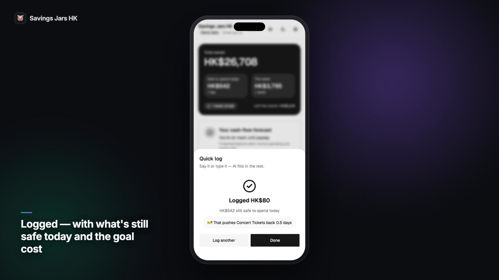

# Savings Jars HK / PocketGoals HK — 香港青年儲蓄助手

Bilingual, mobile-first **savings jar** dashboard for Hong Kong students and young professionals.

| Doc | Purpose |
|-----|---------|
| [`PLAN.md`](PLAN.md) | Product spec, milestones, optional Phase B (Express/PostgreSQL) |
| [`AGENTS.md`](AGENTS.md) | shadcn / Tailwind UI rules for contributors |

**Repository status:** The app is **implemented in this repo root** — React UI, local dev API, SQLite persistence, CSV import, and AI quick log. There is no separate `client/` monorepo folder.

---

## Demo video

[](docs/demo/savings-jars-demo.mp4)

▶️ **[Watch the 3-minute demo](docs/demo/savings-jars-demo.mp4)** — onboarding, safe-to-spend, cash-flow forecast, savings jars, AI Quick log, weekly challenges, insights, privacy, language, and dark mode.

The video is built with [Remotion](https://www.remotion.dev/). See [`demo-video/`](demo-video/README.md) to re-record or re-render.

---

## Key features

| Area | What you get |
|------|----------------|
| **Saving jars** | Named goals (emoji, target HK$), progress rings, top-up, delete |
| **Transactions** | Log **expense**, **income** (payday), **saving** (jar allocations) |
| **Safe to spend** | **Per day** and **per week** from income, rent/MPF, savings %, and this month’s spending |
| **Cash-flow forecast** | 30-day balance chart, low-balance warning, “what if I buy X?” |
| **Charts** | Month income vs expenses vs saved; 6-month net savings; spending by category |
| **Insights** | “Invisible” small repeat spends, subscriptions, cut-back simulator |
| **Round-up** | Optional virtual spare change into a jar (HK$10 / HK$50) |
| **Payday split** | Log salary and auto-split a % across jars |
| **Quick log** | Natural-language / voice expense parsing (dev server → HKBU GenAI or Ollama) |
| **Import / export** | CSV import (`/import`), JSON backup + CSV export in Settings |
| **Privacy** | Hide all HK$ amounts (header eye icon) |
| **Language** | English ↔ 繁體 |
| **Theme** | Light / dark mode |
| **Demo data** | One-tap sample jars and transactions when empty |
| **Offline fallback** | If `/api` is unreachable, collections fall back to `localStorage` |

**HK payment channels** on expenses: Octopus, FPS, PayMe, Alipay HK, credit, cash, bank, other.

---

## Quick start

```bash
cd FinDashboard-BUHack2
npm install          # keep shadcn@4.23.0 in package.json
npm run dev
```

Open **http://localhost:5173** (or the Network URL from the terminal for a phone on the same Wi‑Fi).

| Requirement | Detail |
|-------------|--------|
| Node | **22+** (see `package.json` `engines`) |
| Package manager | **npm** (`package-lock.json` is tracked) |
| Default persistence | SQLite at **`.vibes/data.db`** (gitignored) |

On first run with an empty database you are sent to **`/onboarding`**. Tap **Try demo** or set up your own budget.

### Header controls

| Control | Action |
|---------|--------|
| **EN / 中** | Switch language |
| **Eye** | Hide or show money amounts |
| **Sun / Moon** | Dark mode |
| **Gear** | Budget, round-up, export, **Clear all data** |

### Screens (bottom navigation)

| Route | File | Role |
|-------|------|------|
| `/` | `src/App.tsx` | Dashboard: safe-to-spend, forecast, jars, charts, insights |
| `/activity` | `src/views/activity-view.tsx` | Full transaction list |
| `/goals` | `src/views/goals-view.tsx` | Jar management |
| `/import` | `src/views/import-view.tsx` | CSV import |
| `/onboarding` | `src/Onboarding.tsx` | First-run budget + jars (no bottom nav until you finish) |

Global sheets (expense, top-up, payday, new jar, settings, Quick log) live in `src/components/AppLayout.tsx` and open from the bottom bar or dashboard actions.

---

## Project structure

High-level layout for GitHub browsers and new contributors:

```text
FinDashboard-BUHack2/
├── schema.ts                 # @omg-dev collections: goals, transactions, settings
├── vite.config.ts            # Vite+, router, Tailwind, local DB + AI plugins
├── package.json / package-lock.json
├── index.html
├── public/                   # PWA icons, CSV template (templates/transactions-template.csv)
├── server/                   # Dev-only HTTP middleware (not in production static build)
│   ├── local-db.ts           # SQLite plugin wired by vite.config (primary dev backend)
│   ├── local-api.ts          # Shared REST handlers (/api/*, /api/export)
│   ├── ai-parse.ts           # POST /ai/parse-expense (API keys stay on server)
│   ├── db.ts                   # Drizzle helper for platform builds
│   └── vite-local-api-plugin.ts  # Alternate Vite plugin (not registered in vite.config today)
├── src/
│   ├── main.tsx              # TanStack Router bootstrap
│   ├── App.tsx               # Home dashboard
│   ├── Onboarding.tsx
│   ├── index.css             # Tailwind v4 + semantic design tokens
│   ├── routeTree.gen.ts      # Generated — do not edit
│   ├── routes/                 # File-based TanStack Router routes
│   ├── views/                  # Page bodies for /activity, /goals, /import
│   ├── components/             # App UI (Charts, QuickSheets, QuickLog, …)
│   │   └── ui/                 # Vendored shadcn primitives — do not hand-edit
│   ├── lib/                    # Pure logic + data hooks (see below)
│   ├── db.generated.ts
│   └── db.drizzle.ts
├── demo-video/                 # Remotion demo (separate npm package)
├── docs/demo/                  # Demo video assets
├── functions/                  # Placeholder for serverless hooks
├── PLAN.md · AGENTS.md · README.md
└── vitest.config.ts
```

**Ignored locally:** `node_modules/`, `.vibes/`, `dist/`, `.env*`, `.cursor/`

---

## How the app is wired

```text
main.tsx
  └── RouterProvider
        └── routes/__root.tsx
              PrefsProvider          (lang, theme, hide balances — localStorage)
              DataBackendProvider    (probe /api → "api" or "offline")
              SavingsDataProvider    (goals, txs, settings + CRUD api)
              AppLayout              (header, bottom nav, sheets)
                    └── <Outlet />   (child route: /, /activity, …)
```

**Data flow (online dev mode):**

```text
React views
  → useSavingsData() / useAppCollection()
  → @omg-dev/sdk useCollection
  → GET/POST /api/goals | /api/transactions | /api/settings
  → server/local-db.ts (Vite middleware)
  → SQLite (.vibes/data.db by default)
```

**Quick log (optional AI):**

```text
QuickLog.tsx → fetch POST /ai/parse-expense → server/ai-parse.ts
  → HKBU GenAI (if HKBU_GENAI_API_KEY) or local Ollama
  → reviewed items → api.addTx()
```

See [`.env.example`](.env.example) for AI environment variables.

---

## Important files

### Data & schema

| File | Role |
|------|------|
| [`schema.ts`](schema.ts) | Single source of truth for collection fields and enums |
| [`src/lib/data-backend.tsx`](src/lib/data-backend.tsx) | API vs offline probe; `useAppCollection` wrapper |
| [`src/lib/savings-data.tsx`](src/lib/savings-data.tsx) | App-wide data context, optimistic merges, `api` CRUD |
| [`src/lib/offline-store.ts`](src/lib/offline-store.ts) | localStorage collections when `/api` is down |

### Domain logic (`src/lib/finance.ts`)

Pure TypeScript (no React). Main types: `Goal`, `Tx`, `Settings`.

| Function | Purpose |
|----------|---------|
| `summary` | Safe-to-spend per day/week, monthly totals |
| `goalSaved` | Saved amount per jar from `saving` transactions |
| `cashFlowForecast` | 30-day projected balance |
| `calculateMPF` | HK statutory MPF (5%, caps) |
| `categoryTotals` / `monthlySeries` | Chart inputs |
| `invisibleSpend` / `subscriptions` | Spending insights |
| `cutBack` | Cut-back simulator |
| `savingsStreak` / `challengeStatus` / `weekRecap` | Weekly challenge |
| `spareChange` | Round-up helper |
| `money`, `todayISO`, `addDays` | Formatting and dates |

### UI building blocks

| File | Role |
|------|------|
| [`src/components/AppLayout.tsx`](src/components/AppLayout.tsx) | Shell, navigation, demo/csv banners, sheet orchestration |
| [`src/components/QuickSheets.tsx`](src/components/QuickSheets.tsx) | Expense, top-up, payday, goal, settings sheets |
| [`src/components/QuickLog.tsx`](src/components/QuickLog.tsx) | AI / voice quick expense entry |
| [`src/components/Charts.tsx`](src/components/Charts.tsx) | Progress rings, bar/line charts |
| [`src/lib/i18n.ts`](src/lib/i18n.ts) | EN / 繁 copy |
| [`src/lib/prefs.tsx`](src/lib/prefs.tsx) | User preferences provider |
| [`src/lib/seed.ts`](src/lib/seed.ts) | `seedDemo(api)` sample data |
| [`src/lib/csv-import.ts`](src/lib/csv-import.ts) | CSV parse/validate (unit-tested) |
| [`src/lib/csv-export.ts`](src/lib/csv-export.ts) | Export transactions to CSV |

### Routing

Add a screen by creating `src/routes/<name>.tsx`; `@tanstack/router-plugin` regenerates `src/routeTree.gen.ts`. Navigate with `<Link to="…">` from `@tanstack/react-router`, not raw `<a href>`.

---

## Technology stack

| Layer | Choice |
|-------|--------|
| UI | React 19, TypeScript, TanStack Router |
| Build | Vite+ (`vite-plus`), `@vitejs/plugin-react`, `@omg-dev/vite-plugin` (optional on Bun) |
| Styling | Tailwind CSS v4, **shadcn 4.23.0**, Lucide icons |
| Data client | `@omg-dev/sdk` (`useCollection`) |
| Schema | `@omg-dev/schema` (`schema.ts`) |
| Dev persistence | Node `node:sqlite` via `server/local-db.ts` |
| Tests | Vitest (`src/lib/csv-import.test.ts`) |
| Defaults | HKD, `Asia/Hong_Kong`, English + Traditional Chinese |

---

## Is the backend working? (local dev)

**Yes** for `npm run dev` on Node: `vite.config.ts` enables `localDbPlugin` when `NODE_RUNTIME=node` (default in the `dev` script).

| Piece | Status |
|-------|--------|
| REST | `GET/POST/PATCH/DELETE` on `/api/goals`, `/api/transactions`, `/api/settings` |
| Backup | `GET /api/export` (JSON) — also in Settings |
| Realtime | WebSocket `/__vibes_sub` snapshots + SSE keepalive `/__vibes_events` |
| DB file | **`.vibes/data.db`** unless `VIBES_DB=/path/to/file.db` |
| Production `npm run build` | Static SPA only (`VIBES_LOCAL_DB=false`); pair with hosted API or Phase B per `PLAN.md` |
| User accounts | Not wired — single local user / demo mode |
| Express + PostgreSQL | Optional Phase B — not in this repo yet |

**Smoke test:** Create a jar → refresh → jar persists. In DevTools, `POST /api/goals` should return JSON with an `id`.

Override the database path:

```bash
VIBES_DB=.vibes/test.db npm run dev
```

When not using Node (e.g. Bun with `@omg-dev/vite-plugin`), the same collection paths can be served by the Vibes stack instead of `local-db.ts`.

---

## Demo walkthrough

1. Open `/` on an empty DB → redirect to `/onboarding`.
2. **Try demo** seeds four jars, six months of paydays, and sample spending; header shows a **Demo data** badge. Or **Set up budget** with your numbers.
3. On `/`: safe-to-spend, 30-day forecast (**Test a purchase**), jars, cash flow, categories, insights.
4. Bottom bar: log expense (round-up), top up a jar, payday split, Quick log.
5. **Settings → Clear all data** → back to onboarding.

---

## Scripts

| Command | Purpose |
|---------|---------|
| `npm install` | Install dependencies |
| `npm run dev` | Dev server (port **5173**, host `0.0.0.0`) |
| `npm run build` | Production build → `dist/` |
| `npm run preview` | Serve `dist/` locally |
| `npm run lint` | ESLint |
| `npm run test` | Vitest (`vitest run`) |

---

## Implemented vs gaps

### In the repo today

- [x] Multi-route app (`/`, `/activity`, `/goals`, `/import`, `/onboarding`)
- [x] Jars, expenses, payday, top-up, settings, round-up
- [x] Safe-to-spend, forecast, charts, insights, weekly challenge
- [x] Bilingual UI, dark mode, hide amounts, offline fallback
- [x] Demo seed, CSV import UI + parser tests, JSON/CSV export
- [x] AI quick log (dev server; requires `.env` keys or Ollama)
- [x] Local SQLite via `npm run dev`

### Not done / optional

| Item | Notes |
|------|--------|
| Multi-user auth | `@omg-dev/auth` not integrated |
| Phase B API | Express + PostgreSQL per `PLAN.md` |
| Hosted production deploy | Static build needs a backing API |
| E2E tests | No Playwright suite yet |
| Minor-unit ledger | Whole HKD integers in UI |
| Full account sync | No bank / Octopus live feeds |

### Dependency hygiene

| Issue | Action |
|-------|--------|
| Wrong `shadcn@1.0.0` | Keep **`"shadcn": "4.23.0"`** |
| `npm audit fix --force` | **Avoid** — breaks shadcn CSS |
| UI tokens | Use semantic classes from `AGENTS.md` (`bg-primary`, not `bg-indigo-600`) |

---

## Deploy note (hackathon demo)

Run `npm run dev` on a laptop or VM so judges get API + SQLite on one port. For static hosting only, you still need a collection API (Phase B or a hosted Omg/Vibes deploy) or users stay in offline mode.

---

## Course / hackathon

**BUHack2** — HKBU hackathon savings dashboard.  
**UI name:** Savings Jars HK · **Spec name:** PocketGoals HK (香港青年儲蓄助手).

## License

TBD.